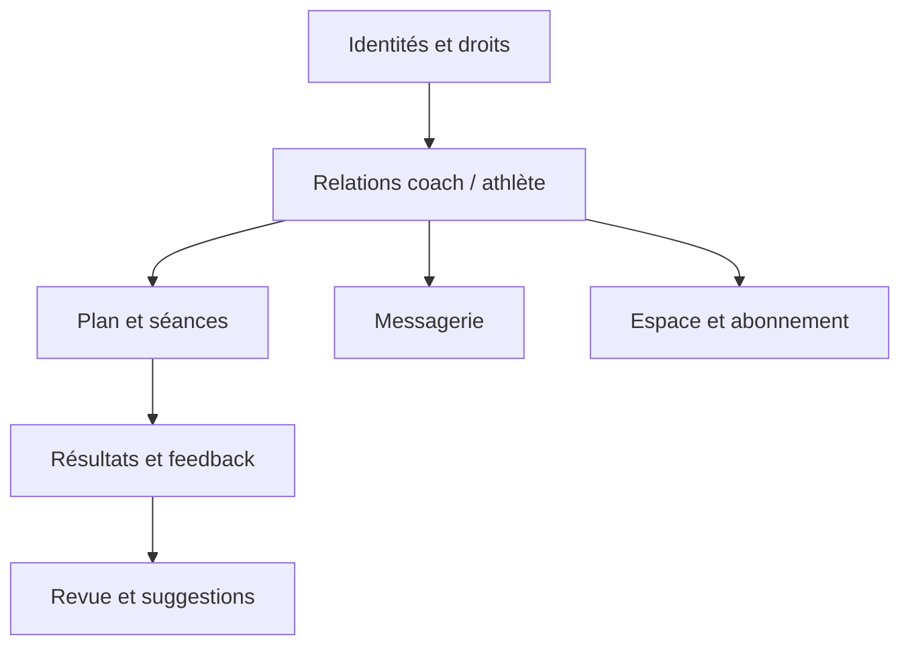
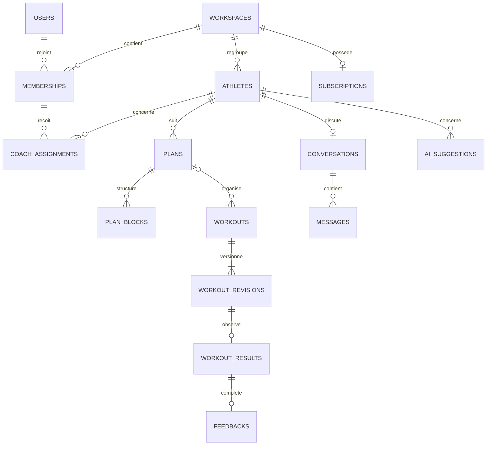

# 05 · Database Design

PostgreSQL sur Supabase, UUID, dates locales et instants UTC. Les clés composées empêchent d’attacher une séance à un athlète appartenant à un autre espace. Les identifiants Auth ne déterminent pas seuls le rôle. Aucune mutation métier directe via Data API. Les commandes serveur vérifient l’acteur et sérialisent les transitions. DDL de référence dans [001_coachos.sql](../database/001_coachos.sql). Le schéma n’a pas été appliqué à Foulée.

## Diagramme logique



## Diagramme relationnel



## Isolation et exploitation

Un propriétaire garde facturation et gestion des droits. Les dossiers sont affectés explicitement, y compris dans un club. Le coach, y compris propriétaire, n’obtient accès au dossier que par affectation active. La règle SELECT reste explicite sur chaque table. Le rôle anonyme n’a aucun accès. La table de sport est un catalogue authentifié. RLS activée partout, y compris sur les tables réservées. Aucun accès client en écriture. Toutes les écritures serveur sont authentifiées par Supabase Auth puis vérifient droits, association, provenance et version dans la transaction, à nouveau avant une publication.

Les helpers security definer ont un search_path vide, des objets qualifiés, des paramètres typés et aucun SQL dynamique. Le propriétaire de migration est distinct du rôle client. Le bypass RLS est réservé au serveur, surveillé et ne fait jamais d’exécution de texte utilisateur. Privatiser les jobs, invitations, clés d’opérations et événements fournisseurs.

Le déploiement exige zéro lecture et zéro écriture hors espace dans les fixtures RLS et API. Vérifier bloc dans son plan, cohérence de la révision de séance, activation d’un seul profil et contraintes de quotas avec transactions concurrentes. Les états archivés conservent l’historique autorisé et bloquent les écritures de dossier. Pas de table de blessures active. Un futur module santé nécessite une décision spécifique, un schéma isolé et une politique de rétention validée.

## Catalogue des tables

### `users`

Profil visible par son titulaire, sans adresse ni donnée Auth copiée.

```sql
id uuid primary key references auth.users(id) on delete cascade,
display_name text not null check (length(display_name) between 1 and 100),
locale text not null default 'fr' check (locale in ('fr','en')),
created_at timestamptz not null default now()
```

Index secondaires. Aucun hors index PK/UNIQUE.
RLS SELECT. Politique `self` définie dans le SQL. Aucune mutation exposée.
Trigger. Aucun. Les contrôles dépendant de plusieurs lignes sont transactionnels.

### `workspaces`

Périmètre de facturation et d’autorisation.

```sql
id uuid primary key default gen_random_uuid(),
name text not null check (length(name) between 1 and 120),
time_zone text not null,
status text not null default 'active' check (status in ('active','read_only','closed')),
created_at timestamptz not null default now()
```

Index secondaires. Aucun hors index PK/UNIQUE.
RLS SELECT. Politique `workspace` définie dans le SQL. Aucune mutation exposée.
Trigger. Aucun. Les contrôles dépendant de plusieurs lignes sont transactionnels.

### `memberships`

Rôles propriétaire et coach.

```sql
workspace_id uuid not null references public.workspaces(id),
user_id uuid not null references public.users(id),
role text not null check (role in ('owner','coach')),
active boolean not null default true,
created_at timestamptz not null default now(),
primary key(workspace_id,user_id)
```

Index secondaires. `user_id, workspace_id`.
RLS SELECT. Politique `membership` définie dans le SQL. Aucune mutation exposée.
Trigger. Aucun. Les contrôles dépendant de plusieurs lignes sont transactionnels.

### `athletes`

Dossier d’athlète dans un espace. Un dossier invité peut n’avoir aucune identité.

```sql
workspace_id uuid not null references public.workspaces(id),
id uuid not null default gen_random_uuid(),
user_id uuid references public.users(id) on delete set null,
display_name text not null check(length(display_name) between 1 and 100),
time_zone text not null,
state text not null check(state in ('invited','active','archived')),
created_at timestamptz not null default now(),
primary key(workspace_id,id), unique(workspace_id,user_id)
```

Index secondaires. `user_id, workspace_id`, `workspace_id,state,display_name,id`.
RLS SELECT. Politique `athlete` définie dans le SQL. Aucune mutation exposée.
Trigger. Aucun. Les contrôles dépendant de plusieurs lignes sont transactionnels.

### `coach_assignments`

Rattachement explicite et durée éventuelle.

```sql
workspace_id uuid not null,
athlete_id uuid not null,
coach_id uuid not null,
starts_at timestamptz not null default now(),
ends_at timestamptz,
created_at timestamptz not null default now(),
primary key(workspace_id,athlete_id,coach_id), foreign key(workspace_id,athlete_id) references public.athletes(workspace_id,id), foreign key(workspace_id,coach_id) references public.memberships(workspace_id,user_id), check(ends_at is null or ends_at>starts_at)
```

Index secondaires. `workspace_id,coach_id,athlete_id`.
RLS SELECT. Politique `assignment` définie dans le SQL. Aucune mutation exposée.
Trigger. Aucun. Les contrôles dépendant de plusieurs lignes sont transactionnels.

### `invitations`

Lien à usage unique. Le jeton brut est envoyé une fois et jamais enregistré.

```sql
workspace_id uuid not null,
athlete_id uuid not null,
id uuid not null default gen_random_uuid(),
secret_hash bytea not null unique,
email_hmac bytea not null,
expires_at timestamptz not null,
used_at timestamptz,
revoked_at timestamptz,
created_at timestamptz not null default now(),
primary key(workspace_id,id), foreign key(workspace_id,athlete_id) references public.athletes(workspace_id,id)
```

Index secondaires. `workspace_id,athlete_id`.
RLS SELECT. Politique `private` définie dans le SQL. Aucune mutation exposée.
Trigger. Aucun. Les contrôles dépendant de plusieurs lignes sont transactionnels.

### `teams`

Groupe organisationnel qui ne confère aucun accès.

```sql
workspace_id uuid not null references public.workspaces(id),
id uuid not null default gen_random_uuid(),
name text not null,
created_at timestamptz not null default now(),
primary key(workspace_id,id), unique(workspace_id,name)
```

Index secondaires. Aucun hors index PK/UNIQUE.
RLS SELECT. Politique `coach_workspace` définie dans le SQL. Aucune mutation exposée.
Trigger. Aucun. Les contrôles dépendant de plusieurs lignes sont transactionnels.

### `team_athletes`

Adhésion à une équipe. Indépendante des permissions.

```sql
workspace_id uuid not null,
team_id uuid not null,
athlete_id uuid not null,
created_at timestamptz not null default now(),
primary key(workspace_id,team_id,athlete_id), foreign key(workspace_id,team_id) references public.teams(workspace_id,id), foreign key(workspace_id,athlete_id) references public.athletes(workspace_id,id)
```

Index secondaires. `workspace_id,athlete_id`.
RLS SELECT. Politique `coach_only` définie dans le SQL. Aucune mutation exposée.
Trigger. Aucun. Les contrôles dépendant de plusieurs lignes sont transactionnels.

### `sports`

Référentiel partagé. Les segments triathlon et duathlon restent des activités séparées.

```sql
code text primary key check(code in ('running','trail','cycling','swimming','triathlon','duathlon'))
```

Index secondaires. Aucun hors index PK/UNIQUE.
RLS SELECT. Politique `catalog` définie dans le SQL. Aucune mutation exposée.
Trigger. Aucun. Les contrôles dépendant de plusieurs lignes sont transactionnels.

### `goals`

Objectif partagé avec l’athlète.

```sql
workspace_id uuid not null,
athlete_id uuid not null,
id uuid not null default gen_random_uuid(),
sport_code text not null references public.sports(code),
title text not null,
target_date date,
state text not null check(state in ('planned','achieved','canceled')),
created_at timestamptz not null default now(),
primary key(workspace_id,id), foreign key(workspace_id,athlete_id) references public.athletes(workspace_id,id)
```

Index secondaires. `workspace_id,athlete_id,target_date`, `sport_code`.
RLS SELECT. Politique `athlete_data` définie dans le SQL. Aucune mutation exposée.
Trigger. Aucun. Les contrôles dépendant de plusieurs lignes sont transactionnels.

### `plans`

Structure de préparation. Visibilité athlète via les séances publiées.

```sql
workspace_id uuid not null,
athlete_id uuid not null,
id uuid not null default gen_random_uuid(),

title text not null,
starts_on date not null,
ends_on date not null check(ends_on >= starts_on),
revision integer not null default 1 check(revision > 0),
created_at timestamptz not null default now(),
primary key(workspace_id,id), unique(workspace_id,athlete_id,id), foreign key(workspace_id,athlete_id) references public.athletes(workspace_id,id)
```

Index secondaires. `workspace_id,athlete_id,starts_on`.
RLS SELECT. Politique `coach_only` définie dans le SQL. Aucune mutation exposée.
Trigger. Aucun. Les contrôles dépendant de plusieurs lignes sont transactionnels.

### `plan_blocks`

Sous période d’un plan. Inclusion vérifiée par la commande.

```sql
workspace_id uuid not null,
athlete_id uuid not null,
id uuid not null default gen_random_uuid(),

plan_id uuid not null,
title text not null,
starts_on date not null,
ends_on date not null check(ends_on >= starts_on),
created_at timestamptz not null default now(),
primary key(workspace_id,id), unique(workspace_id,athlete_id,id), foreign key(workspace_id,athlete_id) references public.athletes(workspace_id,id), foreign key(workspace_id,athlete_id,plan_id) references public.plans(workspace_id,athlete_id,id)
```

Index secondaires. `workspace_id,athlete_id,plan_id`.
RLS SELECT. Politique `coach_only` définie dans le SQL. Aucune mutation exposée.
Trigger. Aucun. Les contrôles dépendant de plusieurs lignes sont transactionnels.

### `workouts`

Identité stable. Le contenu daté est porté par les révisions.

```sql
workspace_id uuid not null,
athlete_id uuid not null,
id uuid not null default gen_random_uuid(),

plan_id uuid,
working_revision integer not null default 1 check(working_revision>0),
published_revision integer check(published_revision>0),
created_at timestamptz not null default now(),
primary key(workspace_id,id), unique(workspace_id,athlete_id,id), foreign key(workspace_id,athlete_id) references public.athletes(workspace_id,id), foreign key(workspace_id,athlete_id,plan_id) references public.plans(workspace_id,athlete_id,id)
```

Index secondaires. `workspace_id,athlete_id,plan_id`.
RLS SELECT. Politique `workout_parent` définie dans le SQL. Aucune mutation exposée.
Trigger. Aucun. Les contrôles dépendant de plusieurs lignes sont transactionnels.

### `workout_revisions`

Versions immuables. Toute annulation est une révision publiée.

```sql
workspace_id uuid not null,
athlete_id uuid not null,
workout_id uuid not null,
number integer not null check(number>0),
local_date date not null,
sort_order integer not null default 0 check(sort_order>=0),
time_zone text not null,
sport_code text not null references public.sports(code),
title text not null check(length(title) between 1 and 120),
instructions text not null default '' check(length(instructions)<=5000),
duration_seconds integer check(duration_seconds between 1 and 86400),
distance_m integer check(distance_m between 1 and 1000000),
intervals jsonb not null default '[]' check(jsonb_typeof(intervals)='array'),
canceled boolean not null default false,
cancellation_reason text,
created_at timestamptz not null default now(),
primary key(workspace_id,athlete_id,workout_id,number), foreign key(workspace_id,athlete_id,workout_id) references public.workouts(workspace_id,athlete_id,id), check(not canceled or cancellation_reason is not null)
```

Index secondaires. `workspace_id,athlete_id,local_date,sort_order,workout_id`, `sport_code`.
RLS SELECT. Politique `workout_revision` définie dans le SQL. Aucune mutation exposée.
Trigger. Immutabilité par trigger.

### `templates`

Modèles de séances et semaines. JSON versionné, validé avant copie.

```sql
workspace_id uuid not null references public.workspaces(id),
id uuid not null default gen_random_uuid(),
owner_id uuid not null,
kind text not null check(kind in ('workout','week')),
title text not null,
payload jsonb not null check(jsonb_typeof(payload)='object'),
shared boolean not null default false,
archived boolean not null default false,
revision integer not null default 1,
created_at timestamptz not null default now(),
primary key(workspace_id,id), foreign key(workspace_id,owner_id) references public.memberships(workspace_id,user_id)
```

Index secondaires. `workspace_id,owner_id,archived`.
RLS SELECT. Politique `coach_workspace` définie dans le SQL. Aucune mutation exposée.
Trigger. Aucun. Les contrôles dépendant de plusieurs lignes sont transactionnels.

### `workout_results`

Résultat déclaré ou import autorisé. Les données Strava ne transitent jamais ici.

```sql
workspace_id uuid not null,
athlete_id uuid not null,
id uuid not null default gen_random_uuid(),

workout_id uuid not null,
workout_revision integer not null,
state text not null check(state in ('completed','partial','missed')),
duration_seconds integer check(duration_seconds between 1 and 86400),
distance_m integer check(distance_m between 1 and 1000000),
source text not null check(source in ('manual','authorized_direct','legacy_unknown')),
revision integer not null default 1,
created_at timestamptz not null default now(),
primary key(workspace_id,id), unique(workspace_id,athlete_id,id), foreign key(workspace_id,athlete_id) references public.athletes(workspace_id,id), foreign key(workspace_id,athlete_id,workout_id,workout_revision) references public.workout_revisions(workspace_id,athlete_id,workout_id,number), unique(workspace_id,athlete_id,workout_id)
```

Index secondaires. `workspace_id,athlete_id,workout_id,workout_revision`.
RLS SELECT. Politique `athlete_data` définie dans le SQL. Aucune mutation exposée.
Trigger. Aucun. Les contrôles dépendant de plusieurs lignes sont transactionnels.

### `feedbacks`

Retour court lié au résultat et révision au moment du retour. Sans champ médical.

```sql
workspace_id uuid not null,
athlete_id uuid not null,
id uuid not null default gen_random_uuid(),

result_id uuid not null,
rpe smallint check(rpe between 0 and 10),
comment text check(length(comment)<=1000),
revision integer not null default 1,
reviewed_at timestamptz,
created_at timestamptz not null default now(),
primary key(workspace_id,id), unique(workspace_id,athlete_id,id), foreign key(workspace_id,athlete_id) references public.athletes(workspace_id,id), foreign key(workspace_id,athlete_id,result_id) references public.workout_results(workspace_id,athlete_id,id), unique(workspace_id,athlete_id,result_id)
```

Index secondaires. `workspace_id,athlete_id,reviewed_at`.
RLS SELECT. Politique `athlete_data` définie dans le SQL. Aucune mutation exposée.
Trigger. Aucun. Les contrôles dépendant de plusieurs lignes sont transactionnels.

### `coach_notes`

Notes privées du coach. Exclues de l’IA par défaut.

```sql
workspace_id uuid not null,
athlete_id uuid not null,
id uuid not null default gen_random_uuid(),

author_id uuid not null,
body text not null check(length(body) between 1 and 2000),
created_at timestamptz not null default now(),
primary key(workspace_id,id), unique(workspace_id,athlete_id,id), foreign key(workspace_id,athlete_id) references public.athletes(workspace_id,id), foreign key(workspace_id,author_id) references public.memberships(workspace_id,user_id)
```

Index secondaires. `workspace_id,author_id`.
RLS SELECT. Politique `coach_only` définie dans le SQL. Aucune mutation exposée.
Trigger. Aucun. Les contrôles dépendant de plusieurs lignes sont transactionnels.

### `conversations`

Un fil textuel par dossier.

```sql
workspace_id uuid not null,
athlete_id uuid not null,
id uuid not null default gen_random_uuid(),

last_activity_at timestamptz,
created_at timestamptz not null default now(),
primary key(workspace_id,id), unique(workspace_id,athlete_id,id), foreign key(workspace_id,athlete_id) references public.athletes(workspace_id,id), unique(workspace_id,athlete_id)
```

Index secondaires. `workspace_id,last_activity_at desc,id`.
RLS SELECT. Politique `athlete_data` définie dans le SQL. Aucune mutation exposée.
Trigger. Aucun. Les contrôles dépendant de plusieurs lignes sont transactionnels.

### `messages`

Message immuable avec identité auteur.

```sql
workspace_id uuid not null,
athlete_id uuid not null,
id uuid not null default gen_random_uuid(),

conversation_id uuid not null,
sender_id uuid references public.users(id) on delete set null,
body text not null check(length(body) between 1 and 4000),
created_at timestamptz not null default now(),
primary key(workspace_id,id), unique(workspace_id,athlete_id,id), foreign key(workspace_id,athlete_id) references public.athletes(workspace_id,id), foreign key(workspace_id,athlete_id,conversation_id) references public.conversations(workspace_id,athlete_id,id)
```

Index secondaires. `workspace_id,athlete_id,conversation_id,created_at,id`, `sender_id`.
RLS SELECT. Politique `athlete_data` définie dans le SQL. Aucune mutation exposée.
Trigger. Aucun. Les contrôles dépendant de plusieurs lignes sont transactionnels.

### `read_receipts`

Position individuelle de lecture.

```sql
workspace_id uuid not null,
athlete_id uuid not null,
conversation_id uuid not null,
user_id uuid not null references public.users(id),
read_through_at timestamptz not null,
read_through_id uuid not null,
created_at timestamptz not null default now(),
primary key(workspace_id,conversation_id,user_id), foreign key(workspace_id,athlete_id,conversation_id) references public.conversations(workspace_id,athlete_id,id)
```

Index secondaires. `user_id,workspace_id`, `workspace_id,athlete_id,conversation_id`.
RLS SELECT. Politique `self_workspace` définie dans le SQL. Aucune mutation exposée.
Trigger. Aucun. Les contrôles dépendant de plusieurs lignes sont transactionnels.

### `review_items`

File d’attention, sans texte médical ni contenu généré.

```sql
workspace_id uuid not null,
athlete_id uuid not null,
id uuid not null default gen_random_uuid(),

kind text not null check(kind in ('feedback','attention','review','manual')),
state text not null check(state in ('open','snoozed','done')),
source_ref uuid not null,
due_at timestamptz,
rank smallint not null check(rank between 0 and 3),
created_at timestamptz not null default now(),
primary key(workspace_id,id), unique(workspace_id,athlete_id,id), foreign key(workspace_id,athlete_id) references public.athletes(workspace_id,id), unique(workspace_id,athlete_id,kind,source_ref)
```

Index secondaires. `workspace_id,state,rank,due_at,id`.
RLS SELECT. Politique `coach_only` définie dans le SQL. Aucune mutation exposée.
Trigger. Aucun. Les contrôles dépendant de plusieurs lignes sont transactionnels.

### `subscriptions`

Projection Stripe. Un abonnement courant par espace.

```sql
workspace_id uuid primary key references public.workspaces(id),
provider_customer_id text not null unique,
provider_subscription_id text unique,
tier text not null check(tier in ('starter','pro','elite')),
status text not null check(status in ('trialing','active','past_due','ended')),
grace_until timestamptz,
current_period_end timestamptz,
created_at timestamptz not null default now()
```

Index secondaires. Aucun hors index PK/UNIQUE.
RLS SELECT. Politique `owner` définie dans le SQL. Aucune mutation exposée.
Trigger. Aucun. Les contrôles dépendant de plusieurs lignes sont transactionnels.

### `invoices`

Métadonnées des factures. Résolution du document chez le fournisseur.

```sql
workspace_id uuid not null references public.workspaces(id),
provider_invoice_id text not null unique,
total_minor bigint not null,
currency text not null check(currency ~ '^[a-z]{3}$'),
status text not null,
created_at timestamptz not null default now(),
primary key(workspace_id,provider_invoice_id)
```

Index secondaires. Aucun hors index PK/UNIQUE.
RLS SELECT. Politique `owner` définie dans le SQL. Aucune mutation exposée.
Trigger. Aucun. Les contrôles dépendant de plusieurs lignes sont transactionnels.

### `coach_dna`

Versions de profil d’un coach. Configuration JSON validée.

```sql
workspace_id uuid not null,
coach_id uuid not null,
version integer not null check(version>0),
state text not null check(state in ('draft','active','retired')),
profile jsonb not null check(jsonb_typeof(profile)='object'),
policy_version text not null,
created_at timestamptz not null default now(),
primary key(workspace_id,coach_id,version), foreign key(workspace_id,coach_id) references public.memberships(workspace_id,user_id)
```

Index secondaires. Aucun hors index PK/UNIQUE.
RLS SELECT. Politique `coach_profile` définie dans le SQL. Aucune mutation exposée.
Trigger. Aucun. Les contrôles dépendant de plusieurs lignes sont transactionnels.

### `dna_candidates`

Règles candidates. Pas de changement du profil actif.

```sql
workspace_id uuid not null,
athlete_id uuid not null,
id uuid not null default gen_random_uuid(),

coach_id uuid not null,
state text not null check(state in ('proposed','accepted','rejected','invalidated')),
candidate jsonb not null check(jsonb_typeof(candidate)='object'),
created_at timestamptz not null default now(),
primary key(workspace_id,id), unique(workspace_id,athlete_id,id), foreign key(workspace_id,athlete_id) references public.athletes(workspace_id,id), foreign key(workspace_id,coach_id) references public.memberships(workspace_id,user_id)
```

Index secondaires. `workspace_id,coach_id,state`.
RLS SELECT. Politique `coach_only` définie dans le SQL. Aucune mutation exposée.
Trigger. Aucun. Les contrôles dépendant de plusieurs lignes sont transactionnels.

### `ai_suggestions`

Brouillons assistant, ancrage et état de revue.

```sql
workspace_id uuid not null,
athlete_id uuid not null,
id uuid not null default gen_random_uuid(),

coach_id uuid not null,
dna_version integer,
module text not null check(module in ('summary','fatigue','anomaly','adaptation','feedback','alert')),
state text not null check(state in ('ready','updated','accepted','rejected','stale','withdrawn')),
model_id text not null,
prompt_version text not null,
evidence_hash text not null,
evidence_refs jsonb not null check(jsonb_typeof(evidence_refs)='array'),
output jsonb not null check(jsonb_typeof(output)='object'),
revision integer not null default 1,
created_at timestamptz not null default now(),
primary key(workspace_id,id), unique(workspace_id,athlete_id,id), foreign key(workspace_id,athlete_id) references public.athletes(workspace_id,id), foreign key(workspace_id,coach_id) references public.memberships(workspace_id,user_id), foreign key(workspace_id,coach_id,dna_version) references public.coach_dna(workspace_id,coach_id,version)
```

Index secondaires. `workspace_id,coach_id,dna_version`, `workspace_id,athlete_id,state,created_at`.
RLS SELECT. Politique `coach_only` définie dans le SQL. Aucune mutation exposée.
Trigger. Aucun. Les contrôles dépendant de plusieurs lignes sont transactionnels.

### `notifications`

Notifications personnelles, sans payload libre.

```sql
workspace_id uuid not null references public.workspaces(id),
id uuid not null default gen_random_uuid(),
user_id uuid not null references public.users(id),
kind text not null,
entity_id uuid,
read_at timestamptz,
created_at timestamptz not null default now(),
primary key(workspace_id,id)
```

Index secondaires. `user_id,workspace_id,created_at,id`.
RLS SELECT. Politique `self_workspace` définie dans le SQL. Aucune mutation exposée.
Trigger. Aucun. Les contrôles dépendant de plusieurs lignes sont transactionnels.

### `audit_logs`

Trace append only des actions sensibles. IDs et codes seulement.

```sql
workspace_id uuid not null references public.workspaces(id),
id bigint generated always as identity,
actor_id uuid references public.users(id) on delete set null,
action text not null,
target_id uuid,
request_id uuid not null,
created_at timestamptz not null default now(),
primary key(workspace_id,id)
```

Index secondaires. `actor_id`, `workspace_id,created_at`.
RLS SELECT. Politique `private` définie dans le SQL. Aucune mutation exposée.
Trigger. Immutabilité par trigger. Exception (D-115, migration `20261123000000`) : dans une transaction d’effacement autorisée (`coachos.erasure_authorized = on`, rôle postgres ou service_role), la suppression d’un compte peut mettre `actor_id` à null ; aucune autre modification n’est acceptée.

### `privacy_requests`

Demandes de droits, suivi interne et purge.

```sql
workspace_id uuid not null references public.workspaces(id),
id uuid not null default gen_random_uuid(),
user_id uuid references public.users(id) on delete set null,
kind text not null check(kind in ('access','erase','portability','correct')),
state text not null check(state in ('open','verifying','processing','completed','denied')),
due_at timestamptz not null,
created_at timestamptz not null default now(),
primary key(workspace_id,id)
```

Index secondaires. `user_id`, `state,due_at`.
RLS SELECT. Politique `private` définie dans le SQL. Aucune mutation exposée.
Trigger. Aucun. Les contrôles dépendant de plusieurs lignes sont transactionnels.

### `operation_keys`

Idempotence des mutations avec empreinte entrée et résultat minimal.

```sql
workspace_id uuid not null references public.workspaces(id),
actor_id uuid not null references public.users(id) on delete cascade,
action text not null,
request_key uuid not null,
request_hash text not null,
response jsonb,
expires_at timestamptz not null,
created_at timestamptz not null default now(),
primary key(workspace_id,actor_id,action,request_key)
```

Index secondaires. `expires_at`, `actor_id`.
RLS SELECT. Politique `private` définie dans le SQL. Aucune mutation exposée.
Trigger. Aucun. Les contrôles dépendant de plusieurs lignes sont transactionnels.

### `jobs`

File PostgreSQL. Payload référentiel, délais et baux. Mise en quarantaine en fin de retries.

```sql
workspace_id uuid not null references public.workspaces(id),
id uuid not null default gen_random_uuid(),
kind text not null,
logical_key text not null,
object_id uuid,
requester_id uuid references public.users(id) on delete set null,
state text not null default 'queued' check(state in ('queued','running','done','dead')),
available_at timestamptz not null default now(),
lease_until timestamptz,
lease_token uuid,
attempts smallint not null default 0,
last_error_code text,
created_at timestamptz not null default now(),
primary key(workspace_id,id), unique(workspace_id,kind,logical_key)
```

Index secondaires. `state,available_at,lease_until`.
RLS SELECT. Politique `private` définie dans le SQL. Aucune mutation exposée.
Trigger. Aucun. Les contrôles dépendant de plusieurs lignes sont transactionnels.

### `stripe_events`

Événements signés dédupliqués. Aucun droit dérivé de l’ordre d’arrivée.

```sql
event_id text primary key,
event_type text not null,
provider_object_id text not null,
state text not null default 'new' check(state in ('new','running','done','dead')),
created_at timestamptz not null default now()
```

Index secondaires. `state,created_at`.
RLS SELECT. Politique `private` définie dans le SQL. Aucune mutation exposée.
Trigger. Aucun. Les contrôles dépendant de plusieurs lignes sont transactionnels.

### `ai_budget`

Réservation et consommation atomique en micro-euros par mois.

```sql
workspace_id uuid not null references public.workspaces(id),
period_start date not null,
budget_micros bigint not null check(budget_micros>=0),
reserved_micros bigint not null default 0 check(reserved_micros>=0),
spent_micros bigint not null default 0 check(spent_micros>=0),
created_at timestamptz not null default now(),
primary key(workspace_id,period_start)
```

Index secondaires. Aucun hors index PK/UNIQUE.
RLS SELECT. Politique `private` définie dans le SQL. Aucune mutation exposée.
Trigger. Aucun. Les contrôles dépendant de plusieurs lignes sont transactionnels.

### `migration_map`

Correspondance idempotente Foulée vers CoachOS. Créée seulement au pilote.

```sql
workspace_id uuid not null references public.workspaces(id),
kind text not null,
source_id text not null,
target_id uuid not null,
checksum text not null,
created_at timestamptz not null default now(),
primary key(workspace_id,kind,source_id), unique(workspace_id,kind,target_id)
```

Index secondaires. Aucun hors index PK/UNIQUE.
RLS SELECT. Politique `private` définie dans le SQL. Aucune mutation exposée.
Trigger. Aucun. Les contrôles dépendant de plusieurs lignes sont transactionnels.

### `publications`

Événement de publication atomique d’un dossier.

```sql
workspace_id uuid not null,
athlete_id uuid not null,
id uuid not null default gen_random_uuid(),
actor_id uuid references public.users(id) on delete set null,
kind text not null check(kind in ('publish','cancel')),
created_at timestamptz not null default now(),
primary key(workspace_id,athlete_id,id), foreign key(workspace_id,athlete_id) references public.athletes(workspace_id,id)
```

Index secondaires. `actor_id`.
RLS SELECT. Politique `private` définie dans le SQL. Aucune mutation exposée.
Trigger. Aucun. Les contrôles dépendant de plusieurs lignes sont transactionnels.

### `publication_items`

Versions rendues visibles lors d’une publication.

```sql
workspace_id uuid not null,
athlete_id uuid not null,
publication_id uuid not null,
workout_id uuid not null,
number integer not null,
created_at timestamptz not null default now(),
primary key(workspace_id,athlete_id,publication_id,workout_id), foreign key(workspace_id,athlete_id,publication_id) references public.publications(workspace_id,athlete_id,id), foreign key(workspace_id,athlete_id,workout_id,number) references public.workout_revisions(workspace_id,athlete_id,workout_id,number)
```

Index secondaires. `workspace_id,athlete_id,workout_id,number`.
RLS SELECT. Politique `private` définie dans le SQL. Aucune mutation exposée.
Trigger. Aucun. Les contrôles dépendant de plusieurs lignes sont transactionnels.

### `workspace_flags`

Drapeaux de disponibilité par espace, évalués côté serveur.

```sql
workspace_id uuid not null references public.workspaces(id),
flag text not null,
enabled boolean not null default false,
created_at timestamptz not null default now(),
primary key(workspace_id,flag)
```

Index secondaires. Aucun hors index PK/UNIQUE.
RLS SELECT. Politique `private` définie dans le SQL. Aucune mutation exposée.
Trigger. Aucun. Les contrôles dépendant de plusieurs lignes sont transactionnels.

### `privacy_notices`

Texte versionné de notice par espace. Seule la version courante est rendue.

```sql
workspace_id uuid not null references public.workspaces(id),
version integer not null check(version>0),
locale text not null check(locale in ('fr','en')),
body text not null,
active boolean not null default false,
created_at timestamptz not null default now(),
primary key(workspace_id,version,locale)
```

Index secondaires. Aucun hors index PK/UNIQUE.
RLS SELECT. Politique `private` définie dans le SQL. Aucune mutation exposée.
Trigger. Aucun. Les contrôles dépendant de plusieurs lignes sont transactionnels.

### `privacy_notice_views`

Preuve de version consultée, distincte d’un consentement.

```sql
workspace_id uuid not null,
version integer not null,
locale text not null,
user_id uuid not null references public.users(id) on delete cascade,
created_at timestamptz not null default now(),
primary key(workspace_id,version,locale,user_id), foreign key(workspace_id,version,locale) references public.privacy_notices(workspace_id,version,locale)
```

Index secondaires. `user_id,workspace_id`.
RLS SELECT. Politique `private` définie dans le SQL. Aucune mutation exposée.
Trigger. Aucun. Les contrôles dépendant de plusieurs lignes sont transactionnels.

### `invitation_delivery`

Enveloppe chiffrée de livraison, supprimée à l’envoi ou à expiration.

```sql
workspace_id uuid not null,
invitation_id uuid not null,
encrypted_envelope bytea not null,
expires_at timestamptz not null,
created_at timestamptz not null default now(),
primary key(workspace_id,invitation_id), foreign key(workspace_id,invitation_id) references public.invitations(workspace_id,id) on delete cascade
```

Index secondaires. `expires_at`.
RLS SELECT. Politique `private` définie dans le SQL. Aucune mutation exposée.
Trigger. Aucun. Les contrôles dépendant de plusieurs lignes sont transactionnels.

### `imports`

Lot V1, référence privée vers CSV temporaire, origine vérifiée et empreinte d’aperçu.

```sql
workspace_id uuid not null,
athlete_id uuid not null,
id uuid not null default gen_random_uuid(),

actor_id uuid references public.users(id) on delete set null,
origin text not null check(origin in ('manual_export','authorized_direct')),
object_key text,
preview_hash text,
state text not null check(state in ('received','previewed','applied','failed','reverted')),
expires_at timestamptz not null,
created_at timestamptz not null default now(),
primary key(workspace_id,id), unique(workspace_id,athlete_id,id), foreign key(workspace_id,athlete_id) references public.athletes(workspace_id,id)
```

Index secondaires. `actor_id`, `expires_at`.
RLS SELECT. Politique `private` définie dans le SQL. Aucune mutation exposée.
Trigger. Aucun. Les contrôles dépendant de plusieurs lignes sont transactionnels.

### `import_rows`

Rapprochement et état par ligne. Aucun corps brut durable.

```sql
workspace_id uuid not null,
athlete_id uuid not null,
import_id uuid not null,
row_no integer not null check(row_no>0),
record_ref uuid,
record_revision integer,
error_code text,
created_at timestamptz not null default now(),
primary key(workspace_id,athlete_id,import_id,row_no), foreign key(workspace_id,athlete_id,import_id) references public.imports(workspace_id,athlete_id,id)
```

Index secondaires. Aucun hors index PK/UNIQUE.
RLS SELECT. Politique `private` définie dans le SQL. Aucune mutation exposée.
Trigger. Aucun. Les contrôles dépendant de plusieurs lignes sont transactionnels.

### `identity_operation_keys`

Idempotence avant que workspace_id existe ou sur action de compte.

```sql
actor_id uuid not null references public.users(id) on delete cascade,
action text not null,
request_key uuid not null,
request_hash text not null,
response jsonb,
expires_at timestamptz not null,
created_at timestamptz not null default now(),
primary key(actor_id,action,request_key)
```

Index secondaires. `expires_at`.
RLS SELECT. Politique `private` définie dans le SQL. Aucune mutation exposée.
Trigger. Aucun. Les contrôles dépendant de plusieurs lignes sont transactionnels.

## Transactions à implémenter

| Commande | Verrous et contrôles |
|---|---|
| Accepter invitation | Verrou espace puis invitation puis dossier. Vérifier hachage, identité, statut, expiration et quota. Activer une fois. |
| Publier | Verrou dossier puis séances triées par ID. Vérifier révisions et toutes les dates. Insérer publications et publication_items, publier pointeurs, créer tâches et journaliser dans le même commit. |
| Enregistrer feedback | Verrou séance, comparer la version publiée envoyée avec la version vue ou déjà référencée. Créer ou corriger résultat et feedback ensemble. |
| Compte et abonnement | Verrou espace pour activation/archivage et droits Stripe. Projection par état courant fournisseur, puis contrôle de quota. |
| Activer DNA | Verrou membership puis profil. Retirer version active, insérer/activer nouvelle, journaliser et ajuster la file. |
| Claim job | Lot borné avec FOR UPDATE SKIP LOCKED, renouvellement de bail et token. L’effet métier dédupliqué est engagé avant marquage done. |

Supprimer les dépendants de manière ordonnée quand une demande validée le requiert. Le rôle d’effacement fixe le paramètre transactionnel uniquement dans la procédure contrôlée. La sauvegarde suit sa propre rétention et les suppressions rejouées après restauration. Les FK composées et index uniques couvrent les chemins décrits. Mesurer les plans des requêtes de revue, calendrier et messagerie sur le jeu S27.

