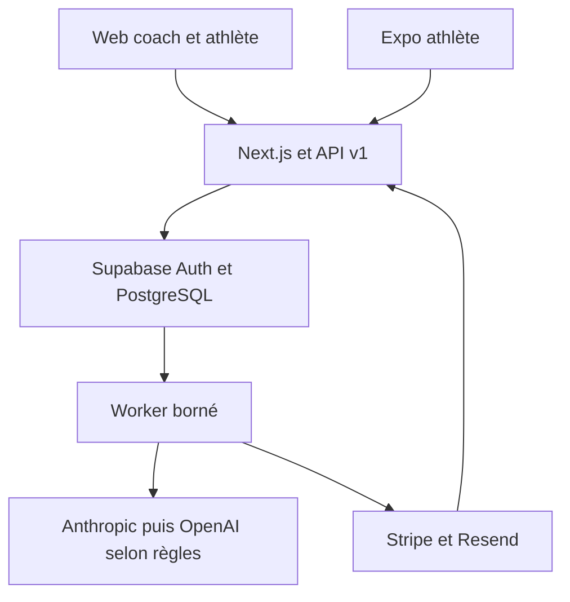

# 07 · Architecture cible

Un monorepo GitHub, une application Next.js sur Vercel, un compagnon Expo et un Supabase par environnement. PostgreSQL reste la source des plans, droits, tâches et projections. Les services extérieurs ont chacun un adaptateur. La logique de domaine reste testable sans réseau.

| Module | Emplacement | Responsabilité |
|---|---|---|
| Web | apps/web/app | App Router, pages server-first, formulaires et zones interactives client, protection de route par session et contexte. |
| Mobile | apps/mobile | Expo Router, Auth Supabase, stockage jetons SecureStore, cache mémoire scoped par identité et espace, liens universels. |
| Domain | packages/domain | Règles pures de transition, unité, résultat et profil. Aucun appel externe. |
| Contrats | packages/contracts | Validation TypeScript, DTO et OpenAPI. Pas de dépendance sur l’UI. |
| Infra | apps/web/server | Accès données et adaptateurs Stripe, Resend, Anthropic, OpenAI, drapeaux serveur. |
| DB | supabase/migrations | Tables, contraintes, index, RLS et transactions. SQL de référence dans le package. |
| Workers | supabase/functions | Tâches par lots bornés, déclenchement Cron serveur, délais et reprise, aucun appel public utilisable avec un jeton client. |

## Front Web

Sitemap de la section 03. Routes privées rendues dynamiquement. Aucune mise en cache partagée des données personnelles. Les pages serveur lisent le dépôt en contexte, les mutations appellent les commandes du domaine et OpenAPI. Toute mutation Web à cookie vérifie Origin et la session. Utiliser des requêtes paginées et projections explicites. Retirer le côté client après authentification expirée. Le calendrier propose cellules, vue liste équivalente et contrôle au clavier. Les états de version concurrente contiennent une action de rechargement.

## Mobile

Le compagnon affiche les séances publiées, le feedback, les objectifs et le fil. L’athlète est gratuit. Stripe reste dans la console coach Web. Vérifier les règles de chaque boutique et les métadonnées à la soumission. Réserver le stockage sécurisé aux jetons. Aucun contenu de séance ou message sur disque au MVP. En cas d’interruption, garder la saisie en mémoire tant que l’écran est ouvert, reprendre avec la même clé. Au logout, effacer cache et navigation privée. Manipuler liens d’invitation par URLs vérifiées, état à usage unique et reprise après authentification. Supporter un binaire Expo précédent pendant les migrations.

## Backend et transactions

API REST unique pour les clients. Le serveur authentifie, valide, vérifie l’entitlement et appelle une transaction de domaine. Lectures user scoped avec RLS et projections DTO. L’écriture passe par des commandes incrémentales et atomiques. Les credentials serveur sont dans le worker ou la couche commande et les contrôles de droits sont réévalués au commit. Révocation et permissions sont lues depuis PostgreSQL, sans dépendre d’un claim de rôle historique. Le support n’est pas un super coach. Accès technique de secours limité dans le temps, avec justification et trace. Ne pas ajouter de service distribué si un worker borné satisfait la charge.

## Flux critiques

- Invitation. Créer l’empreinte du jeton, l’état et l’outbox dans une transaction. Le secret reste dans le lien privé, éphémère, avec stockage chiffré temporaire si nécessaire pour l’envoi. Vérifier email Auth, existence, durée, usage et quota dans une transaction.
- Publication. Verrouiller l’athlète et les révisions ciblées, écrire pointeurs de publication et outbox. Le client reçoit le nouvel état après commit. Une notification ne détermine jamais la visibilité.
- Assistant. Snapshot minimisé et versionné, réserve de coût, job isolé, sortie typée, revérification des preuves et droits au retour. Aucun outil ou canal d’écriture à disposition du modèle.
- Stripe. HMAC vérifié sur le corps brut, inbox unique par eventId, worker sérialisé par espace et état Stripe courant. Traiter les notifications comme signaux de rapprochement. Fiche locale lue par les commandes.
- Envoi. Clé stable par effet, bail, reprise exponentielle avec jitter, tentatives bornées et quarantaine. En cas d’incertitude côté fournisseur, obtenir l’état avant de retenter si l’API le permet. Un envoi échoué ne revient pas sur la transaction d’origine.

## Sécurité et données

Vérifier classification, base juridique et finalités selon données. Aucune ingestion médicale dédiée dans le MVP. Limiter accès, accès support et contrats sous-traitants. Restreindre les régions là où le fournisseur le permet, recenser les transferts effectifs et leurs garanties. Filtrer les PII dans PostHog et Sentry, désactiver replay sur les pages privées et refuser toute propriété inconnue. Supabase Storage privé sur les exports. Sessions séparées par environnement, rotation des secrets et MFA des comptes opérateurs. Aucun secret dans NEXT_PUBLIC_, variables Expo publiques ou messages. Les demandes d’accès et d’effacement ont une trace. Référence réglementaire RGPD art. 5, 6, 9, 12 à 22, 28, 32 à 35 et 44 à 49. Les rôles et bases s’évaluent par traitement avec le responsable. [RGPD](https://eur-lex.europa.eu/legal-content/FR/TXT/PDF/?uri=CELEX%3A32016R0679)

## Échelle et budget

À 20 000 athlètes, 4 séances planifiées par semaine et 52 semaines, ordre de grandeur 4,16 M de séances par an. Avec 1,4 révision moyenne, 5,82 M de révisions. Mesurer le poids des lignes et index, dont les JSON structurés, puis projeter stockage, WAL et sauvegardes. Préparer une fixture à deux ans, 1 000 espaces et quelques portefeuilles à 300. Hypothèse initiale de charge 60 requêtes de lecture/s et 10 écritures/s pendant 20 min, avec pics de connexion, publications et remise en route des jobs. Adapter après mesure réelle.

Cibles initiales staging en région de lancement, p95 lecture ≤400 ms, mutation sans dépendance externe ≤700 ms, affichage initial coach ≤2,5 s sur réseau cible, erreur serveur <1 % et file critique p95 <2 min. Alerte de saturation si attente pool et CPU augmentent pendant plusieurs fenêtres. Mesurer et optimiser requêtes, index et taille des lots avant d’augmenter compute. Étudier partitionnement seulement si purge ou maintenance dépassent le budget après optimisation. RTO ≤4 h, RPO ≤24 h au pilote, à établir lors d’une répétition. Avant une exigence plus stricte, chiffrer et activer la solution de sauvegarde correspondante.

[Supabase Auth](https://supabase.com/docs/guides/auth) · [RLS](https://supabase.com/docs/guides/database/postgres/row-level-security) · [Next.js](https://nextjs.org/docs/app) · [Expo SecureStore](https://docs.expo.dev/versions/latest/sdk/securestore/) · [Stripe webhooks](https://docs.stripe.com/webhooks) · [App Review Guidelines](https://developer.apple.com/app-store/review/guidelines/)
