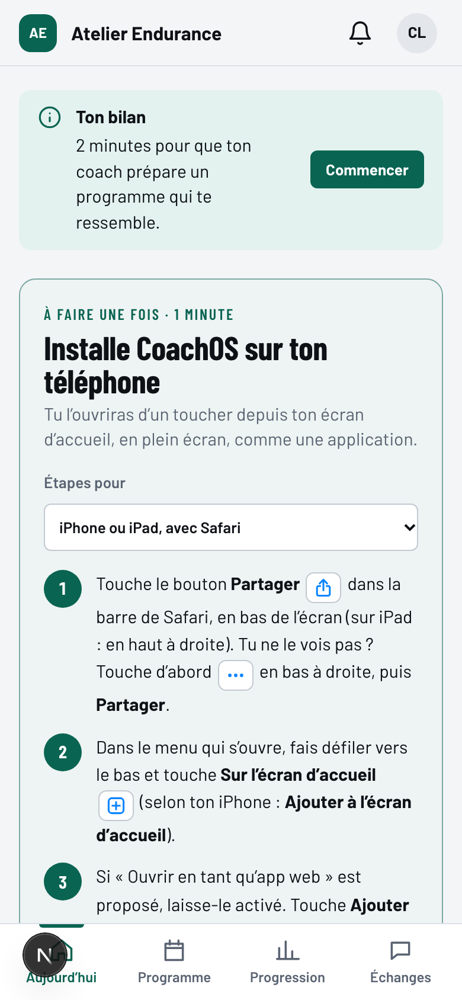
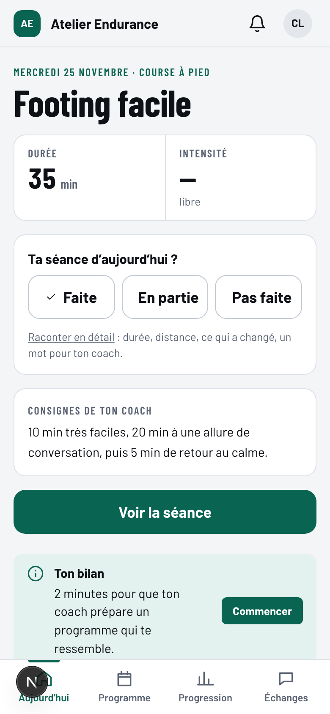
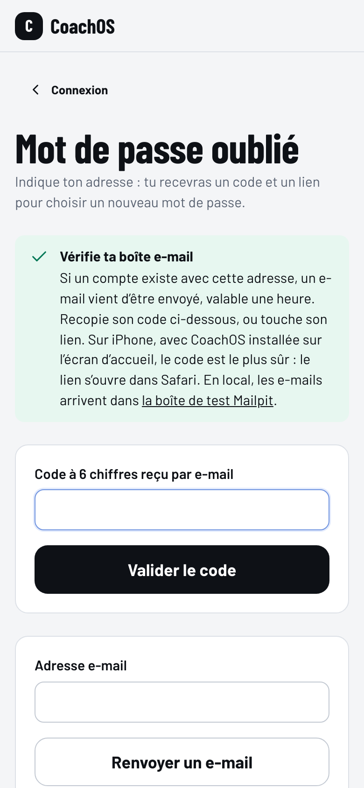
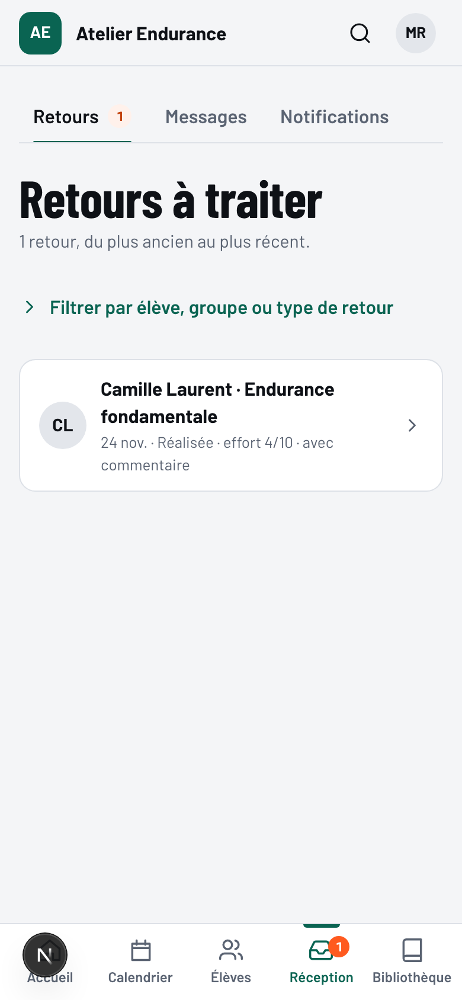
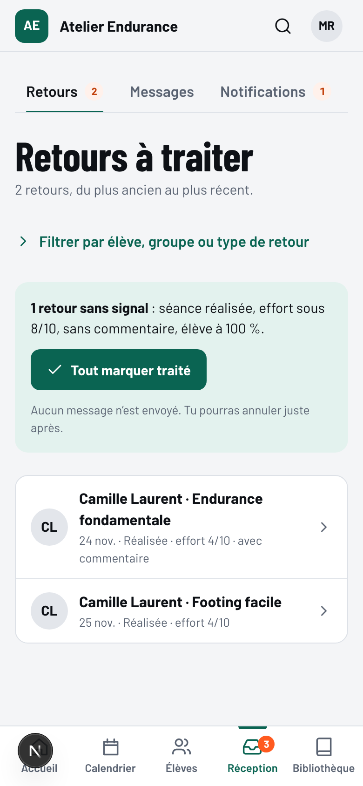
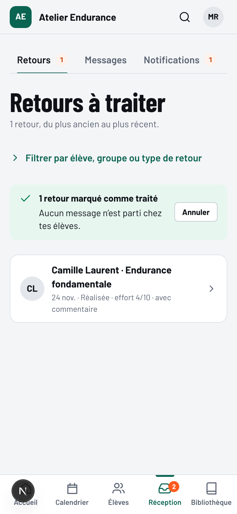

# Bilan produit · fluidité coach et élève

25 novembre 2026 · branche `fluidite` (rien n’est fusionné). Stripe est en pause, à la demande du fondateur.

**Méthode.** Les parcours ont été faits sur téléphone (390 × 844 px, navigateur d’iPhone simulé), uniquement avec des comptes fictifs : Camille (élève) et Marine (coach) sur une base de démonstration neuve. Aucun vrai élève, aucune base en ligne. Les captures se refont avec `node scripts/bilan-captures.mjs avant|apres`, le serveur fictif tournant (`bash scripts/demo-server.sh`).

Chaque changement est un commit séparé, qu’on peut garder ou retirer seul :

| Commit | Changement |
|---|---|
| `89c3ae5` | Élève : la séance du jour et son retour sur le premier écran |
| `79fc0fa` | iPhone : « Mot de passe oublié » par code à 6 chiffres (correctif) |
| `d140f0c` | Coach : traiter d’un geste les retours sans signal, avec « Annuler » |
| `4690b32` | Coach : « Marquer comme traité » enchaîne sur le retour suivant |
| `33495a2` | Tests : ordre du parcours de fluidité (aucun effet sur l’app) |

## 1. Élève : la séance du jour d’abord

| Avant | Après |
|---|---|
|  |  |

- **Avant** : en ouvrant l’app, l’élève voyait la carte du bilan puis le grand guide d’installation. Le bouton « Faite » était à 1 494 px du haut : presque deux écrans à faire défiler avant de pouvoir répondre.
- **Après** : la séance, sa durée et « Faite / En partie / Pas faite » sont sur le premier écran (bouton à 325 px). Ensuite viennent les consignes, puis le bilan et l’installation, toujours proposés plus bas.
- **Gestes** : ouvrir l’app, puis « Faite », puis le ressenti. Cela fait 2 touchers et 0 défilement, contre 2 touchers après environ 2 écrans de défilement.
- **Ce que ça change** : l’élève dit ce qu’il a fait en trois secondes en sortant de sa séance, sans chercher.

## 2. iPhone : « Mot de passe oublié » qui marche dans l’app installée (correctif)

- **Le problème.** L’app installée sur l’écran d’accueil d’un iPhone ne partage pas sa session avec Safari. Le lien de l’e-mail (protocole PKCE) ne marchait que dans le navigateur qui avait fait la demande. Ouvert dans Safari après une demande faite depuis l’app, il échouait (« Ce lien n’est plus valable »). Ce diagnostic est tiré du code ; je ne l’ai pas reproduit sur un vrai iPhone.
- **Après** : l’e-mail contient un **code à 6 chiffres** à recopier dans l’app, ainsi qu’un lien vérifié par le serveur, qui marche dans n’importe quel navigateur. Les tentatives de code sont limitées (20 par quart d’heure et par connexion, 5 codes faux par adresse).
- **Vérifié sur Supabase local**, avec un compte fictif et un e-mail réel reçu dans Mailpit :
  - code saisi dans « l’app » : on arrive sur « Nouveau mot de passe » ;
  - lien ouvert dans un autre navigateur, sans rien en commun avec celui de la demande : on arrive aussi sur « Nouveau mot de passe » ;
  - code faux : message clair, pas de session.
- **Connexion habituelle** : elle se fait par adresse et mot de passe, saisis dans l’app elle-même. Elle ne dépend d’aucun lien d’e-mail et marchait déjà dans l’app installée.
- **À faire par le fondateur avant de fusionner ce commit** : copier le contenu de `supabase/templates/recovery.html` dans Supabase › **Authentication** › **Email Templates** › **Reset Password**, puis **« Save »**. Sinon, l’e-mail en ligne n’aura pas de code alors que l’écran en demande un.

## 3. Coach : les retours sans signal en un geste

| Avant | Après | Après le geste |
|---|---|---|
|  |  |  |

- **Avant** : chaque retour, même « Faite, facile, sans commentaire », demandait d’ouvrir le retour, de faire défiler, de toucher « Marquer comme traité » puis de revenir. Cela fait 3 touchers et un défilement par retour.
- **Après** : un bandeau compte les retours sans signal (séance réalisée, effort sous 8/10, sans commentaire, élève à 100 %). « Tout marquer traité » les clôt en **1 toucher**, et **« Annuler »** les remet dans la file. Il n’y a aucune fenêtre de confirmation et aucun message ne part chez l’élève. Les retours avec commentaire, effort élevé ou élève pas à 100 % restent à lire.
- **Ordre de grandeur** : un coach de 15 élèves à 4 séances par semaine reçoit environ 60 retours. Si les deux tiers sont sans signal, il passe d’environ 120 touchers à 1 pour ceux-là. C’est une estimation, pas une mesure.
- **Droits testés** : la coach de l’espace peut annuler ; un coach d’un autre espace, l’élève elle-même et un élève d’un autre espace sont refusés.

## 4. Coach : enchaîner les retours à lire

- **Avant** : après « Marquer comme traité », on restait sur le retour traité et il fallait toucher « Retour suivant ».
- **Après** : le retour suivant s’ouvre directement (même filtre), avec « Retour précédent traité · voici le suivant ». Depuis le calendrier, rien ne change.
- **Ce que ça change** : un toucher de moins par retour lu, et on traite la file d’une traite.

## Vérifications

- Typecheck OK.
- 473 tests unitaires, dont les droits en base table par table et profil par profil (D-127, D-161), plus les nouveaux tests.
- 14 parcours de bout en bout, dont le nouveau `e2e/aa-fluidite.spec.ts`.
- Construction OK.
- **Cloisonnement** : je n’ai trouvé aucun chemin qui laisse un coach voir les élèves d’un autre coach, ni un élève voir les données d’un autre. Les matrices de droits existantes passent. La seule route ajoutée (« Annuler ») est testée avec les quatre profils.
- **Hors ligne** : la séance du jour reste lisible sans réseau (service worker, D-080, tests existants). Le navigateur intégré de l’app de bureau ne laisse pas passer ce service worker vers un serveur local : c’est une limite de cet outil, pas de CoachOS.
- **Bug trouvé, sans rapport avec CoachOS** : le serveur local du port 3000 renvoyait des erreurs 500 sur les nouvelles routes, à cause de son cache abîmé par une construction. Un serveur neuf répond correctement.

**Ce que je n’ai pas parcouru dans cette session** (à faire dans la suivante, avec la même méthode) :
- côté coach : inscription et installation, saisie de la méthode, génération et retouche d’un programme, gestion d’une quinzaine d’élèves, imprévus ;
- côté élève : questionnaire du bilan, progression.

Ce bilan ne couvre donc que les gestes quotidiens : séance, retour, file des retours, et l’accès à l’app sur iPhone.

## Propositions non faites

| Proposition | Pourquoi | Effort |
|---|---|---|
| « Décaler la suite » d’un élève (blessure, course avancée) : toutes les séances à venir de N jours, avec « Annuler » | Aujourd’hui on déplace séance par séance, et chaque séance publiée doit être republiée | Moyen |
| Sur l’Accueil coach, ne plus lister chaque « Examiner le retour » en tâche : la Réception les montre déjà | Doublon : le même retour apparaît à deux endroits | Petit (retrait d’un type de suivi automatique : à ta décision) |
| « Pas faite » part en un toucher, sans « Annuler » | Un mauvais toucher envoie l’info au coach ; on peut corriger par « Compléter », mais ce n’est pas évident | Petit |
| Onglets des Paramètres sur téléphone : l’onglet ouvert peut être hors de l’écran | On ne voit pas où l’on est | Petit |
| Parcourir les flux restants (programme, méthode, quinzaine d’élèves, questionnaire) | Pas couvert par ce bilan | Moyen |

## Verdict

**Un coach pourrait s’en servir lundi avec de vrais élèves, sans toi à côté, pour planifier, publier et lire les retours. Mais l’envoi des invitations par e-mail attend toujours le nom de domaine (il faut passer par le lien à copier).**

- **Pour qu’il la préfère à un tableur avec WhatsApp ou à Nolio**, il manque surtout des gestes groupés face aux imprévus (décaler la suite d’un élève ou d’un groupe), la synchronisation montre et Strava (Garmin en attente), et une preuve chiffrée du temps gagné.
- **Avant de l’essayer avec tes élèves** : le nom de domaine pour les e-mails, le modèle d’e-mail « Reset Password » à coller, et ton essai de cinq minutes ci-dessous.

## Ton test de cinq minutes (sur ton téléphone)

À faire une fois la branche fusionnée, ou sur un aperçu qui n’écrit pas dans ta base (voir ci-dessous) :

1. Connecte-toi avec un compte élève de test et ouvre l’app depuis l’icône de l’écran d’accueil. La séance du jour et « Faite » doivent être visibles sans faire défiler. Touche « Faite » puis un ressenti, et compte : 2 touchers.
2. Déconnecte-toi, puis touche « Mot de passe oublié ? » **dans l’app installée**. Recopie le code reçu par e-mail : tu dois arriver sur « Nouveau mot de passe », sans passer par Safari.
3. Avec ton compte coach : Réception › Retours. Touche « Tout marquer traité », puis « Annuler » : les retours reviennent.
4. Ouvre un retour avec commentaire et touche « Marquer comme traité » : le suivant doit s’ouvrir seul.

## Aperçu Vercel

**Pas de lien d’aperçu pour l’instant**, pour deux raisons :
1. je ne peux pas pousser la branche moi-même (identifiants GitHub absents de ma session) ;
2. surtout, un aperçu Vercel utilise par défaut les mêmes réglages Supabase que la production : **il écrirait dans la base de tes vrais élèves**.

Pour un aperçu sans risque, il faut un second projet Supabase gratuit, réservé aux aperçus. Ses clés iraient dans Vercel › Environment Variables, en cochant seulement **Preview**. Je peux te guider pas à pas quand tu veux.
